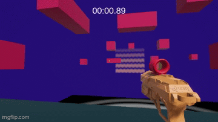

# Grapple-W

A physics-based 3D parkour/platformer built in Unity, centered on a Spring Joint grappling hook, momentum-driven movement, and time-attack level completion.


[](https://4yu-san.itch.io/grapple-w)

<p align="center">
  
  <br>
  
</p>


## What is this?

Grapple-W is a first-person movement sandbox: swing across the map with a Spring Joint grappling hook, chain momentum from Dani-style rigidbody movement (bunnyhop-friendly counter-movement + crouch slides), and race the clock to hit the end zone before your best time. Levels are timed and scored, with a couple of custom animated shaders driving the visual feedback (the pulsing "portal" end zone in particular).

This is an active, evolving project — expect some stub systems (wallrunning is scaffolded but not yet implemented) and iteration on feel and level design.

## Quick Start

Want to just play it? **[Play on itch.io](https://4yu-san.itch.io/grapple-w)** — no setup required.

To run it from source instead:

```bash
git clone https://github.com/4yu-san/Grapple-W.git
```

1. Open the project in **Unity Hub** using editor version `6000.4.0f1` (see [Installation](docs/INSTALLATION.md) if you don't have it installed).
2. Open `Assets/Scenes/MainMenu.unity`.
3. Hit Play.

## Controls

| Action | Input |
|---|---|
| Move | `WASD` |
| Look | Mouse |
| Jump | `Space` |
| Crouch / Slide | `Left Ctrl` |
| Fire Grapple | `Left Click` |
| Pull Towards Grapple | `Right Click` (hold) |
| Shoot | `E` |
| Pause | `Esc` |

## Documentation

This README stays high-level on purpose — the deeper stuff lives in its own pages:

| Page | What's in it |
|---|---|
| [📦 Installation](docs/INSTALLATION.md) | Unity version, cloning, opening the project, running builds |
| [✨ Features](docs/FEATURES.md) | Grappling hook, movement system, timer/best-time, shaders, audio, UI flow |
| [🏗️ Architecture](docs/ARCHITECTURE.md) | Folder layout, script responsibilities, manager/singleton pattern, scenes |
| [🧩 Challenges & Learnings](docs/CHALLENGES.md) | The hard parts of building this — starting with wrangling the singleton pattern |
| [🖼️ Screenshots](docs/SCREENSHOTS.md) | Gallery of the game in action |

## Tech Stack

- **Engine:** Unity 6000.4.0f1 (Unity 6)
- **Render Pipeline / Shaders:** Custom Unlit ShaderLab + HLSL shaders (CGPROGRAM), hand-written (no Shader Graph here)
- **Physics:** Unity's built-in `Rigidbody` + `SpringJoint` for the grapple and rigidbody-based FPS movement
- **UI Text:** TextMesh Pro

## Credits

- Core rigidbody movement (`PlayerMovement.cs`) is adapted from **Dani's** well-known FPS movement tutorial/base — kept and extended for this project's crouch-slide and momentum feel.

## License

No license file is currently present in the repo — treat this as "all rights reserved" by default unless/until one is added. Add a `LICENSE` file if you want to open this up for reuse.
